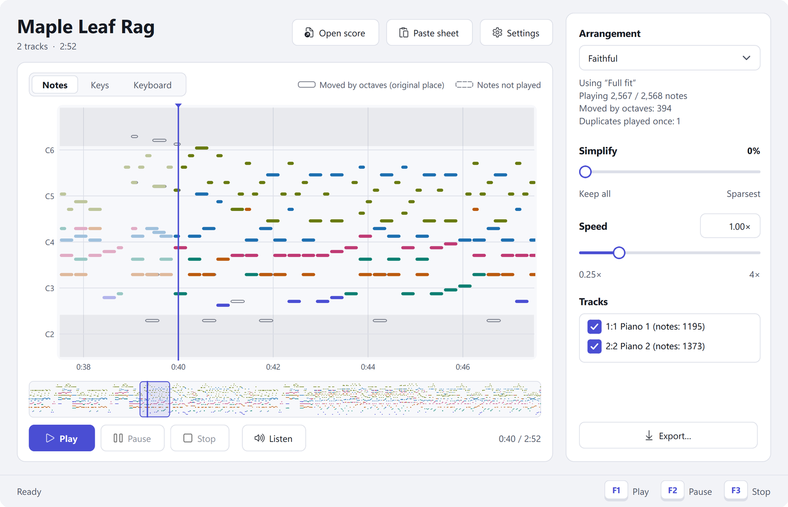
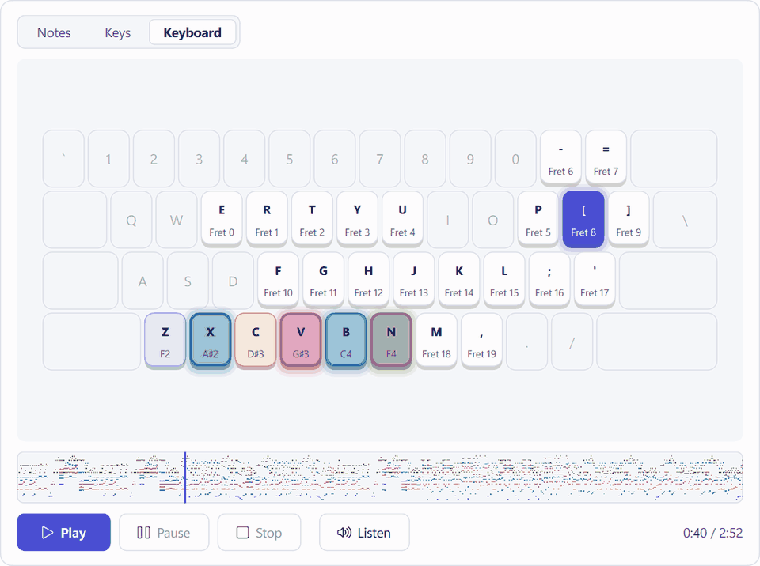
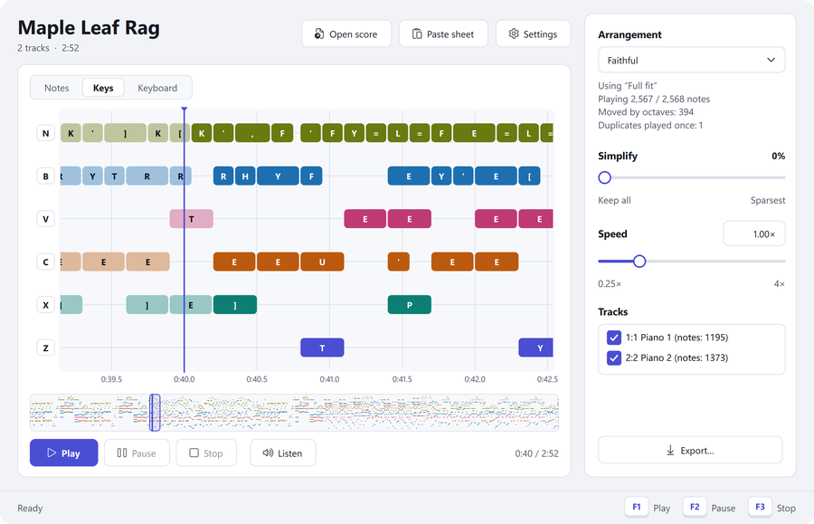
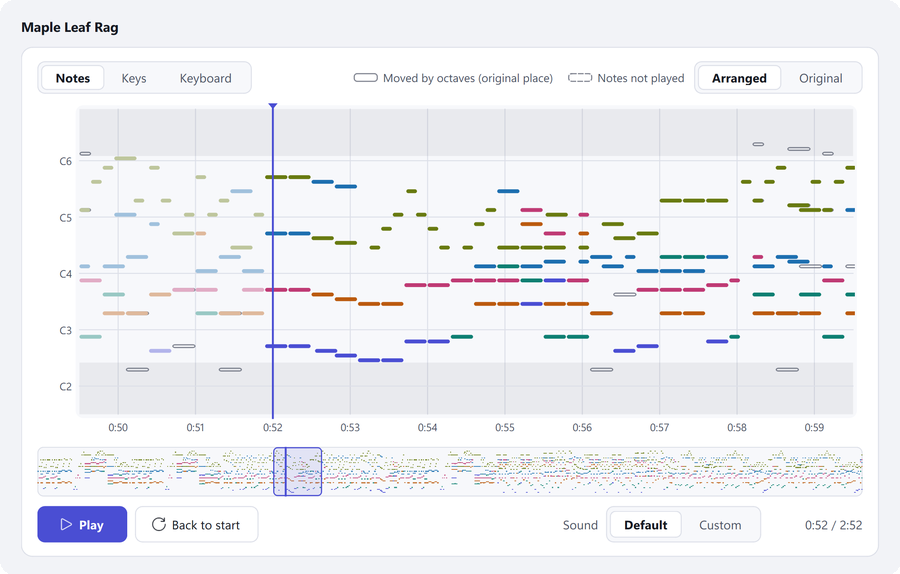
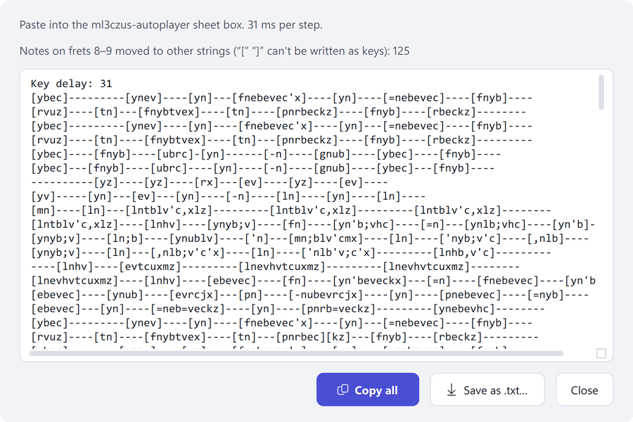
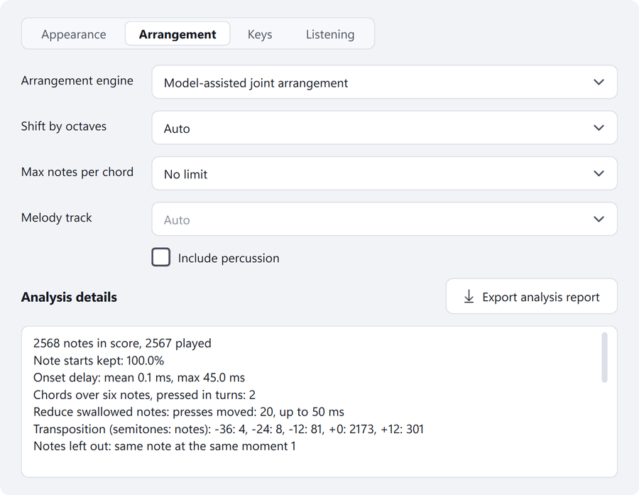
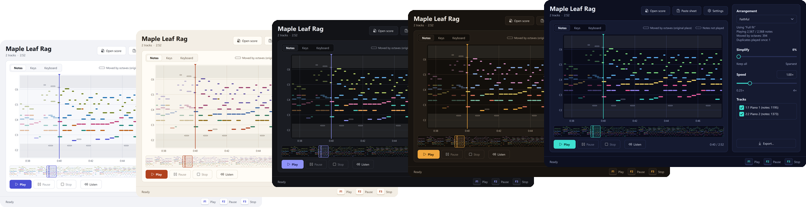

<div align="center">


# Sloppy Player

**Play MIDI and MusicXML scores on the Roblox guitar.**
Arranged for the game's six strings, played with millisecond timing.

[](https://github.com/Akureyri-i/sloppy-player/releases)
[](https://github.com/Akureyri-i/sloppy-player/releases)
[](https://github.com/Akureyri-i/sloppy-player/stargazers)
[](LICENSE)


[](https://github.com/Akureyri-i/sloppy-player/releases/latest)
[](USER_GUIDE.md)
[](README.zh-CN.md)

</div>

> [!NOTE]
> **Sloppy Player is a vibe-coded project.** All of its code was written by AI models, GPT 6 Astra and Claude Opus 5.5. Akureyri directed the work and made the decisions, but did not write the code.

<picture>
  <source media="(prefers-color-scheme: dark)" srcset="assets/hero-dark.png">
  
</picture>

## Highlights

**Piano scores become playable.** A piano piece spans seven octaves; the guitar in Roblox has three and a half. Sloppy Player does not throw away what does not fit. A local music model (M2BERT) reads the score and scores which notes belong to the same voice, and an optimiser (OR-Tools CP-SAT) moves notes by octaves so that every voice stays connected and phrases keep their shape. In *Maple Leaf Rag*, 2,567 of its 2,568 notes are played, 394 of them moved by an octave. On Bach chorales the voice model finds the next note of a voice 96.1% of the time.

**A guitar arrangement when you want one.** *Guitar style* keeps a solo-guitar skeleton: the melody, the bass, the root and third of each chord. Its density and register follow statistics from 403 human guitar arrangements; its melody line found 96.7% of the sung notes in 96 piano scores with lyrics.

**Millisecond timing.** Every note is pressed at its own time in the score. During playback the key thread runs at the highest priority with high-resolution timers, and the interpreter switches threads every 0.5 ms. In an in-game test recording, 95% of the moments started within 2.6 ms of schedule.

**Built around how the game behaves.** Every note sends its fret key and its string key. Strings are released independently, so other notes keep ringing. The length of each of the game's 44 pitches was measured, and notes that would land where the game swallows a repeated pitch are moved by a few milliseconds.

**Everything runs on your computer.** The model runs on the CPU; no GPU, no account, no telemetry. A typical piece is analysed in 10 to 20 seconds the first time and instantly after that.

<div align="center">
<picture>
  <source media="(prefers-color-scheme: dark)" srcset="assets/keyboard-dark.gif">
  
</picture>
</div>

<div align="center">
<a href="https://www.youtube.com/watch?v=5cWug4iWrBU"></a>
</div>

## Features

<table>
<tr>
<td width="50%" valign="top">

<p><b>Three arrangements.</b> <i>Faithful</i> keeps the whole score, <i>Guitar style</i> a guitar skeleton, <i>As written</i> changes nothing. <b>Simplify</b>, <b>Speed</b> (0.25–4×) and the track list adjust the result; the side panel says what was moved or left out and why.</p>
</td>
<td width="50%" valign="top">

<p><b>Listen first.</b> Play the arrangement or the original from any point, with the Windows MIDI synthesizer or your own SFZ, SF2 or SF3 sound pack.</p>
</td>
</tr>
<tr>
<td valign="top">

<p><b>Open and export.</b> MIDI, MusicXML (.musicxml, .mxl, repeats and jumps unfolded) and ml3czus-autoplayer sheets, which can also be pasted in as text. Export to MIDI on the score's bars, MusicXML with notation and tab, or an ml3czus-autoplayer sheet.</p>
</td>
<td valign="top">

<p><b>See how it was arranged.</b> Analysis details list the notes kept, the octave moves, onset delays and the model's part in the result, and can be saved as a report.</p>
</td>
</tr>
</table>



Five colour schemes (Frost, Rice paper, Night, Amber, Neon) and seven languages: English, Español, Português (Brasil), Русский, Bahasa Indonesia, 简体中文, 繁體中文.

## Quick start

1. Download `SloppyPlayer-1.1.0-win64.zip` from [Releases](https://github.com/Akureyri-i/sloppy-player/releases/latest) and unzip it anywhere.
2. Run `SloppyPlayer.exe` and open a score (or drag it onto the window).
3. Click **Listen** to hear the arrangement.
4. Press **F1**, switch to Roblox within 3 seconds and hold the guitar. **F2** pauses, **F3** stops.

The [user guide](USER_GUIDE.md) explains every setting.

> [!IMPORTANT]
> Sloppy Player simulates keyboard input. Check the rules of Roblox and of the experience you play in before using it; you use it at your own risk. This project is not affiliated with Roblox Corporation.

## FAQ

<details>
<summary><b>Which scores work best?</b></summary>

Any MIDI or MusicXML file can be opened and arranged, but some sound better than others. Best results come from:

- solo piano scores and piano arrangements (pop, anime and game music, most classical piano pieces);
- scores written in notation software (MuseScore and the like) or MIDI files with clean, even timing.

Expect a weaker result with:

- **very dense music**: many notes at once or fast runs in several hands. The game has six strings, and every key press takes Windows a fraction of a millisecond, so large chords are pressed in quick groups and some notes may be left out;
- **orchestral or many-track scores**: everything has to fit into three and a half octaves, so voices crowd together. Untick the tracks you don't need;
- **MIDI recorded from a live performance**: uneven timing and heavy pedal blur chords and phrases;
- **a melody that is not on top** (in the bass or an inner voice): *Guitar style* may follow the wrong line. Choose the melody track in Settings → Arrangement;
- **the same note repeated very fast**: the game can swallow some of the repeats.

When a piece sounds crowded, try *Simplify*, a lower *Speed*, fewer tracks or *Guitar style*, and listen again.
</details>

<details>
<summary><b>Windows says "Windows protected your PC".</b></summary>

The program is not code-signed. Click **More info**, then **Run anyway**. The full source is in this repository if you prefer to build it yourself.
</details>

<details>
<summary><b>Why does the first analysis take a while?</b></summary>

A piece that does not fit the guitar's range is analysed with the model and the optimiser the first time it is opened: usually 10 to 20 seconds, a few minutes for long, dense pieces. The result is cached; changing speed or key timing afterwards only reschedules the keys.
</details>

<details>
<summary><b>Where are my settings?</b></summary>

Settings are in `%APPDATA%\SloppyPlayer`, the analysis cache in `%LOCALAPPDATA%\SloppyPlayer`. Deleting the program folder and these two folders removes everything.
</details>

<details>
<summary><b>Can I add or fix a translation?</b></summary>

Yes. Put a language file (for example `fr.json`, in the format of [guitar_player/locales](guitar_player/locales)) in `%APPDATA%\SloppyPlayer\languages\`, or open a pull request.
</details>

<details>
<summary><b>Build from source</b></summary>

Python 3.12, 64-bit, on Windows.

```
python -m venv .venv
.venv\Scripts\python -m pip install -r requirements.txt -r requirements-model.txt
.venv\Scripts\python tools/setup_model.py --install
.venv\Scripts\python launch.py
```

`setup_model.py --install` downloads the official M2BERT checkpoint, checks its SHA-256 and converts it to ONNX (this step installs PyTorch and Transformers; the player itself runs the model with ONNX Runtime). Without the model the player still runs and arranges without it.

Tests: `.venv\Scripts\python -m unittest discover -s tests`

Release build:

```
.venv\Scripts\python -m pip install pyinstaller
.venv\Scripts\python tools/build_exe.py
```

The training scripts for the two small models in `models/m2bert/` are in `tools/`; see the [model card](models/m2bert/MODEL_CARD.md). Their training data is not included.
</details>

## Acknowledgements

Sloppy Player stands on the following work. Details and licenses: [THIRD_PARTY.md](THIRD_PARTY.md).

**Models and data**

- **M2BERT**: Jun-You Wang, Li Su. *Improving BERT for symbolic music understanding using token denoising and pianoroll prediction.* ISMIR 2025. [Code](https://github.com/york135/M2BERT), [weights](https://github.com/york135/M2BERT_files). The note encoder of the arranger.
- **ModernBERT** (Warner et al., 2024): the encoder configuration M2BERT builds on.
- **POP909** (Wang et al., ISMIR 2020): training data for the voice-role model.
- **music21**'s Bach chorales (Cuthbert & Ariza, ISMIR 2010): training data for the voice-link model.
- **AnimeTAB** (Zhou, Ju & Xie, 2022): guitar texture statistics behind *Guitar style*.
- **PDMX** (Long et al., 2024), **MERT** (Li et al., ICLR 2024) and the **FluidR3_GM** sound font: used during development to evaluate and tune arrangements. *Maple Leaf Rag* in the screenshots is a public-domain score from PDMX.

**Methods**

- Uitdenbogerd & Zobel, ACM Multimedia 1999: the "skyline" (top note) melody.
- Nakamura & Sagayama, ICMC 2015: octave-move costs from human piano reductions.
- Hsiao & Su, ISMIR 2021; Karystinaios, Foscarin & Widmer, IJCAI 2023: voices as links between notes.
- Kosta et al., ISMIR 2022: note features for melody identification.

**Formats and tools**

- [ml3czus-autoplayer](https://github.com/ml3czus/ml3czus-autoplayer) by @ml3czus_: the sheet format Sloppy Player reads and writes.
- [MIDIPlusPlus](https://github.com/Zephkek/MIDIPlusPlus): its key-sending code was studied as a reference.
- MusicXML (W3C Music Notation Community Group).
- PySide6 / Qt, OR-Tools, ONNX Runtime, NumPy, mido, keyboard, tinysoundfont, PyInstaller; PyTorch, Transformers, safetensors and ONNX to convert and train the models.

## License

Copyright (C) 2026 Akureyri

Sloppy Player is free software under the [GNU General Public License v3.0 or later](LICENSE). The M2BERT encoder is not covered by this license; it is distributed with its authors' permission.
