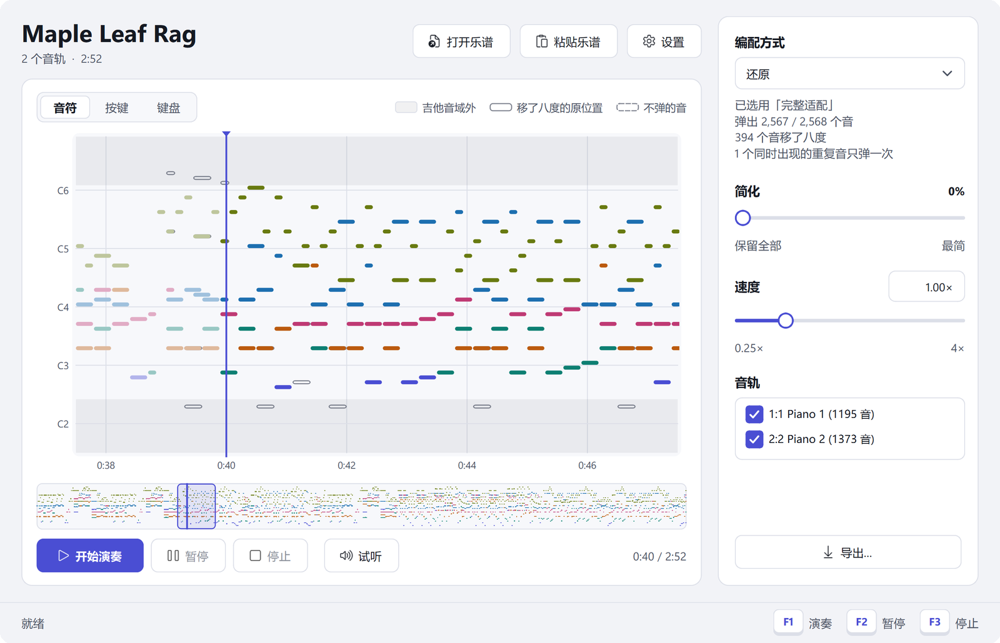
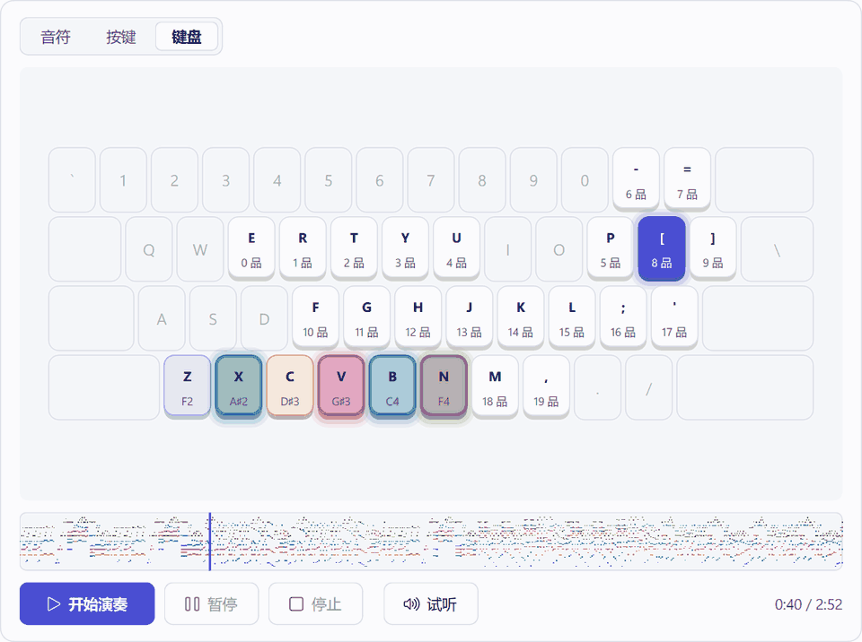
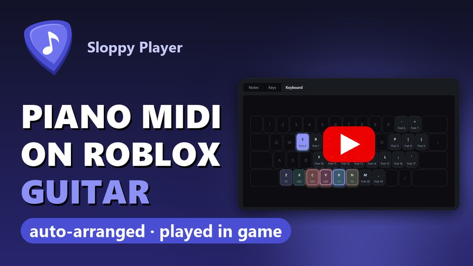
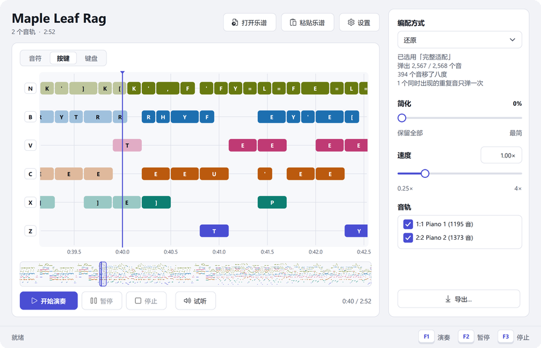
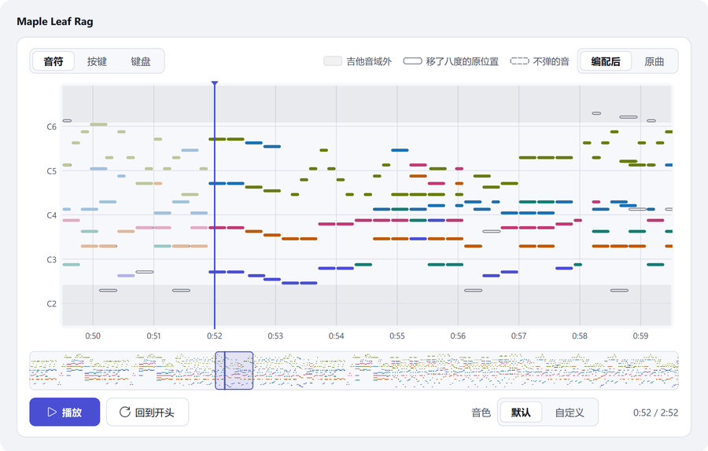
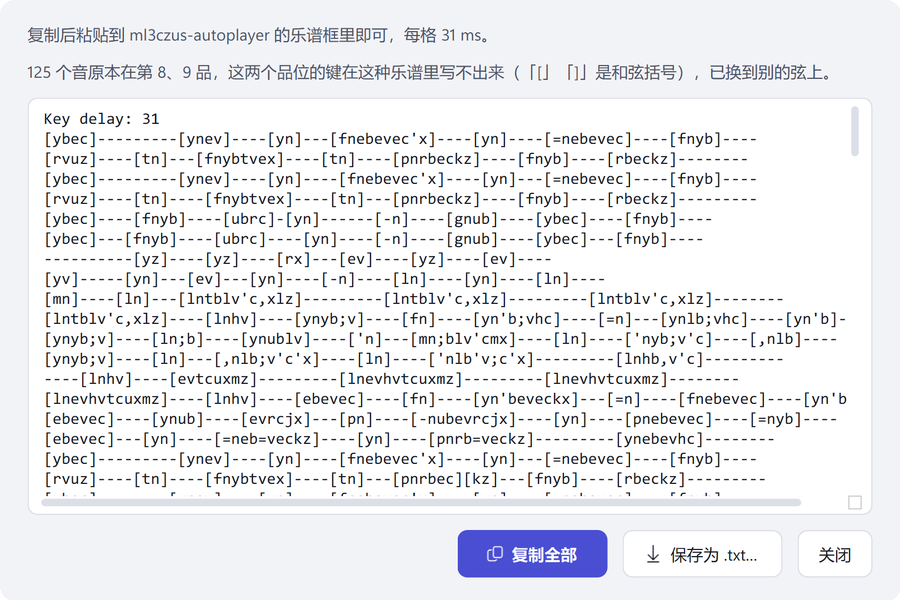
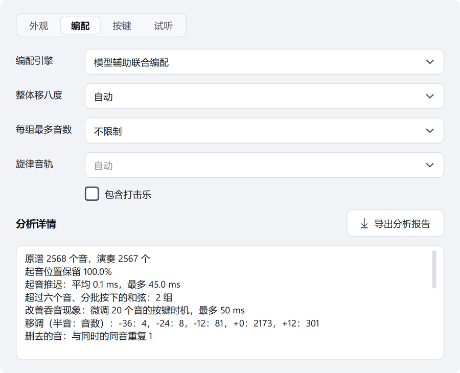
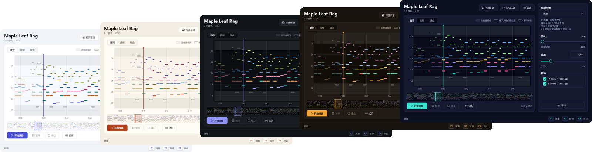

<div align="center">


# Sloppy Player

**用 Roblox 吉他弹 MIDI 和 MusicXML 乐谱。**
按游戏的六根弦编配，以毫秒级的时间精度演奏。

[](https://github.com/Akureyri-i/sloppy-player/releases)
[](https://github.com/Akureyri-i/sloppy-player/releases)
[](https://github.com/Akureyri-i/sloppy-player/stargazers)
[](LICENSE)


[](https://github.com/Akureyri-i/sloppy-player/releases/latest)
[](USER_GUIDE.zh-CN.md)
[](README.md)

</div>

> [!NOTE]
> **Sloppy Player 是一个 Vibe Coding 项目。** 全部代码由 AI 模型 GPT 6 Astra 和 Claude Opus 5.5 编写。Akureyri 负责指导和做决定，没有编写代码。

<picture>
  <source media="(prefers-color-scheme: dark)" srcset="assets/hero-dark.zh-CN.png">
  
</picture>

## 技术亮点

**钢琴谱也能弹。** 钢琴曲横跨七个八度，Roblox 的吉他只有三个半。Sloppy Player 不把放不下的音直接扔掉：本地音乐模型（M2BERT）读谱，判断哪些音属于同一个声部；优化器（OR-Tools CP-SAT）再按八度移动音符，让每个声部保持连贯、乐句保持原来的走向。以《枫叶拉格》为例，2,568 个音弹出了 2,567 个，其中 394 个移了八度。在巴赫众赞歌上，声部模型找到同一声部下一个音的准确率是 96.1%。

**想要吉他味就切「吉他化」。** 它留下吉他独奏的骨架：旋律、低音，以及每个和弦的根音与三音。疏密和音区按 403 首真人吉他编配的统计来定；在 96 首带歌词的钢琴谱上，它找出了 96.7% 的演唱音。

**毫秒级的时间精度。** 每个音都在它在曲中的时刻按下。演奏时发键线程用最高优先级和高精度计时器，Python 解释器每 0.5 ms 就切换一次线程。一次游戏内测试录音中，95% 的时刻与计划相差不到 2.6 ms。

**按游戏的实际行为设计。** 每个音都发品位键和弦键；各根弦独立松开，其他弦上的音继续响。游戏里 44 个音高的余音长度都实测过；如果某个音正好落在游戏会“吞掉”重复音的时刻，就把它挪开几毫秒。

**全部在你的电脑上运行。** 模型用 CPU 运行，不需要显卡，不需要账号，没有遥测。一首普通长度的曲子第一次分析约 10–20 秒，之后打开就是现成的。

<div align="center">
<picture>
  <source media="(prefers-color-scheme: dark)" srcset="assets/keyboard-dark.zh-CN.gif">
  
</picture>
</div>

<div align="center">
<a href="https://www.youtube.com/watch?v=5cWug4iWrBU"></a>
</div>

## 功能

<table>
<tr>
<td width="50%" valign="top">

<p><b>三种编配方式。</b>「还原」保留整首内容，「吉他化」留下吉他骨架，「原样演奏」什么都不改。「简化」「速度」（0.25–4×）和音轨选择可以调整结果；侧栏会写出哪些音移了八度、哪些没弹以及原因。</p>
</td>
<td width="50%" valign="top">

<p><b>先试听。</b> 从任意位置播放编配后或原曲，用 Windows 自带的 MIDI 合成器或你自己的 SFZ、SF2、SF3 音色包。</p>
</td>
</tr>
<tr>
<td valign="top">

<p><b>打开与导出。</b> 支持 MIDI、MusicXML（.musicxml、.mxl，反复与跳转按演奏顺序展开）和 ml3czus-autoplayer 乐谱，乐谱也可以直接粘贴文字。可导出按原谱小节写的 MIDI、带六线谱的 MusicXML，或 ml3czus-autoplayer 乐谱。</p>
</td>
<td valign="top">

<p><b>看得到怎么编的。</b> 分析详情列出保留的音、移八度、起音推迟和模型的参与情况，也可以导出为报告。</p>
</td>
</tr>
</table>



五套配色（霜白、宣纸、夜幕、琥珀、霓虹），七种界面语言：English、Español、Português (Brasil)、Русский、Bahasa Indonesia、简体中文、繁體中文。

## 快速上手

1. 在 [Releases](https://github.com/Akureyri-i/sloppy-player/releases/latest) 下载 `SloppyPlayer-1.0.0-win64.zip`，解压到任意位置。
2. 运行 `SloppyPlayer.exe`，打开乐谱（或把文件拖进窗口）。
3. 点「试听」听一遍编配结果。
4. 按 **F1**，3 秒内切到 Roblox 并拿好吉他。**F2** 暂停，**F3** 停止。

各项设置见[使用指南](USER_GUIDE.zh-CN.md)。

> [!IMPORTANT]
> Sloppy Player 会模拟键盘输入。使用前请自行了解 Roblox 及所在游戏的规则，风险自负。本项目与 Roblox 公司无关。

## 常见问题

<details>
<summary><b>什么样的乐谱效果最好？</b></summary>

任何 MIDI 或 MusicXML 文件都能打开和编配，但效果有好有坏。效果最好的是：

- 钢琴独奏谱和钢琴改编谱（流行、动漫、游戏音乐，以及大多数古典钢琴曲）；
- 用打谱软件（MuseScore 等）写的乐谱，或节奏整齐的 MIDI。

以下情况效果会差一些：

- **音特别密**：同时按很多音，或多个声部一起快速跑动。游戏只有六根弦，每次按键 Windows 也要花零点几毫秒，大和弦会分几批快速按下，有些音可能弹不出来；
- **管弦乐或音轨很多的谱子**：全部内容要塞进三个半八度，声部会挤在一起。可以取消勾选不需要的音轨；
- **现场演奏录下来的 MIDI**：节奏不均、踏板很重，和弦和乐句容易糊在一起；
- **旋律不在最上面**（在低音或中间声部）：「吉他化」可能跟错旋律。可以在 设置 → 编配 里指定旋律音轨；
- **同一个音重复得非常快**：游戏可能吞掉其中一部分。

听起来太挤时，可以试试「简化」、降低「速度」、少选几条音轨，或者换成「吉他化」，再试听一遍。
</details>

<details>
<summary><b>Windows 提示“Windows 已保护你的电脑”。</b></summary>

程序没有代码签名。点 **更多信息**，再点 **仍要运行**。如果你更放心自己构建，完整源码都在这个仓库里。
</details>

<details>
<summary><b>第一次分析为什么要等一会儿？</b></summary>

超出吉他音域的曲子，第一次打开时要用模型和优化器分析：一般 10–20 秒，长而密的曲子要几分钟。结果会缓存，之后调速度或按键时序只需重新排键。
</details>

<details>
<summary><b>设置保存在哪里？</b></summary>

设置在 `%APPDATA%\SloppyPlayer`，分析缓存在 `%LOCALAPPDATA%\SloppyPlayer`。删掉程序文件夹和这两个文件夹，就全部清除了。
</details>

<details>
<summary><b>可以添加或修改翻译吗？</b></summary>

可以。把语言文件（例如 `fr.json`，格式同 [guitar_player/locales](guitar_player/locales)）放进 `%APPDATA%\SloppyPlayer\languages\`，或者提交 pull request。
</details>

<details>
<summary><b>从源码构建</b></summary>

64 位 Windows 上的 Python 3.12。

```
python -m venv .venv
.venv\Scripts\python -m pip install torch==2.8.0 -r requirements.txt -r requirements-model.txt
.venv\Scripts\python tools/setup_model.py --install --cpu
.venv\Scripts\python launch.py
```

`setup_model.py` 从官方地址下载 M2BERT 权重并校验 SHA-256。没有它也能运行，只是编配不使用模型。

测试：`.venv\Scripts\python -m unittest discover -s tests`

打包发布版：

```
.venv\Scripts\python -m pip install pyinstaller
.venv\Scripts\python tools/export_encoder_weights.py
.venv\Scripts\python tools/build_exe.py
```

`models/m2bert/` 里两个小模型的训练脚本在 `tools/`，说明见[模型说明](models/m2bert/MODEL_CARD.md)；训练数据不在仓库中。
</details>

## 致谢

Sloppy Player 建立在以下工作之上。详情与许可见 [THIRD_PARTY.md](THIRD_PARTY.md)。

**模型与数据**

- **M2BERT**：Jun-You Wang, Li Su. *Improving BERT for symbolic music understanding using token denoising and pianoroll prediction.* ISMIR 2025。[代码](https://github.com/york135/M2BERT)、[权重](https://github.com/york135/M2BERT_files)。编配用的音符编码器。
- **ModernBERT**（Warner et al., 2024）：M2BERT 所基于的编码器配置。
- **POP909**（Wang et al., ISMIR 2020）：声部角色模型的训练数据。
- **music21** 收录的巴赫众赞歌（Cuthbert & Ariza, ISMIR 2010）：音线连接模型的训练数据。
- **AnimeTAB**（Zhou, Ju & Xie, 2022）：「吉他化」所用的吉他织体统计。
- **PDMX**（Long et al., 2024）、**MERT**（Li et al., ICLR 2024）和 **FluidR3_GM** 音色库：开发中用于评估和调整编配。截图里的《枫叶拉格》是 PDMX 中的公有领域乐谱。

**方法**

- Uitdenbogerd & Zobel, ACM Multimedia 1999：取最高音的 skyline 旋律法。
- Nakamura & Sagayama, ICMC 2015：来自人工钢琴缩编统计的移八度代价。
- Hsiao & Su, ISMIR 2021；Karystinaios, Foscarin & Widmer, IJCAI 2023：把声部看作音符之间的连接。
- Kosta et al., ISMIR 2022：旋律识别的音符特征。

**格式与工具**

- [ml3czus-autoplayer](https://github.com/ml3czus/ml3czus-autoplayer)（@ml3czus_）：Sloppy Player 读写的乐谱格式。
- [MIDIPlusPlus](https://github.com/Zephkek/MIDIPlusPlus)：参考了它的发键代码。
- MusicXML（W3C 乐谱记谱社区组）。
- PySide6 / Qt、OR-Tools、PyTorch、Transformers、safetensors、NumPy、mido、keyboard、tinysoundfont、PyInstaller。

## 许可证

Copyright (C) 2026 Akureyri

Sloppy Player 是自由软件，按 [GNU 通用公共许可证 第 3 版或更高版本](LICENSE) 发布。M2BERT 编码器不受此许可证约束，经其作者许可随附。
